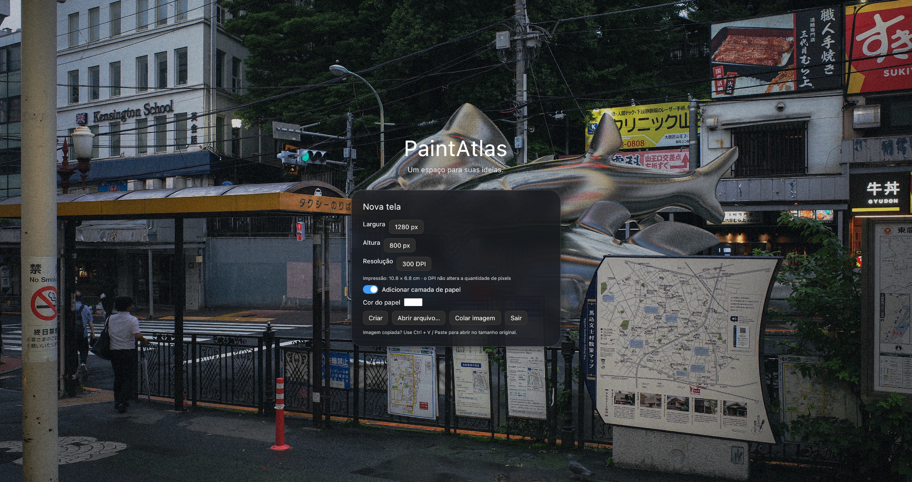
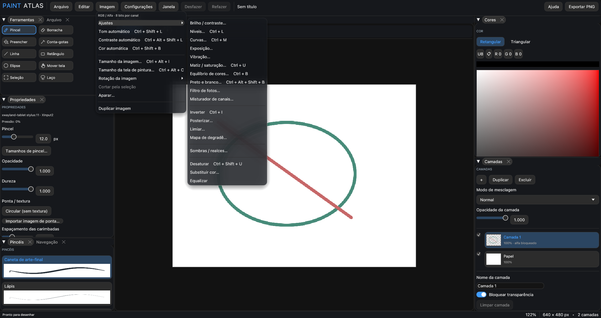
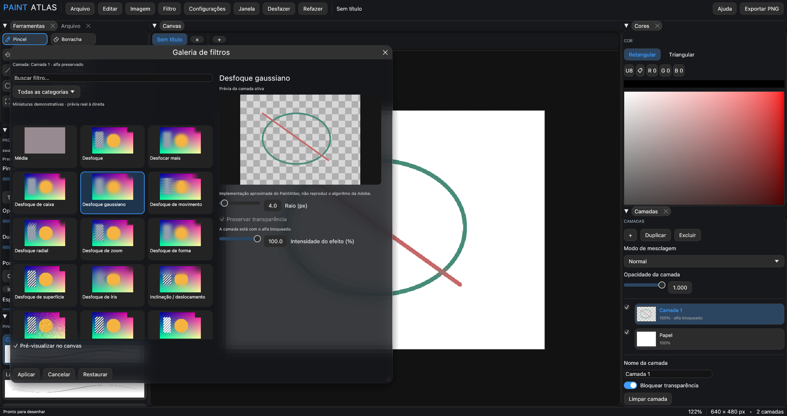

# PaintAtlas

A cross-platform raster drawing studio built in **Rust**, with an interface available in English and Brazilian Portuguese. A personal project inspired by Clip Studio Paint's illustration workflow: brushes, layers, selections, and transforms, with dockable panels and translucent glass styling. Linux supports pressure-sensitive tablets through XInput2/evdev; Windows supports standard pointer input.

[Source code on GitHub](https://github.com/Krueels/PaintAtlas)



Startup screen featuring original artwork by [Krueels](https://github.com/Krueels).

## Build and run

Requirements: stable Rust with Cargo and a C compiler/linker. Linux requires a desktop session and OpenGL-capable graphics drivers. Windows builds natively with the MSVC Rust toolchain. Vulkan can be selected in Settings on platforms with a Vulkan-capable driver; OpenGL remains the default. File dialogs use the native platform integration; on Linux they use `xdg-desktop-portal`. Install `curl` to import images from URLs on Linux.

From the project directory:

```bash
./compile.sh
./target/debug/paintatlas
```

`compile.sh` is a convenience wrapper; it is optional. The original `compilar.sh` name remains available as a compatibility alias. The equivalent command is `cargo build` (or `cargo build --release` for an optimized build).

Or run directly with Cargo:

```bash
cargo run
```

For an optimized build:

```bash
./compile.sh --release
./target/release/paintatlas
```

Keep `assets/default_brushes/` next to the executable when distributing a local copy with the brush tip pack. The splash background and Inter font are embedded in the executable.

## AppImage (Linux x86_64)

This packaging step is optional. Use it only if you want a portable Linux AppImage; the app can also be run from Cargo or distributed in another format. Build the AppImage with:

```bash
./generate-appimage.sh
```

The executable package, SHA256 checksum, and build information are written to `dist/`. The script downloads and caches [linuxdeploy](https://github.com/linuxdeploy/linuxdeploy) under `target/appimage-tools/`; it does not install system-wide tools. Use `--skip-build` to package an existing release executable. The package includes the default brush pack, Inter license, curl for browser image downloads, and the libraries loaded dynamically for X11, Wayland, and tablet input. User settings remain in the usual user configuration directory.

Launch the result directly, or without FUSE using:

```bash
./dist/PaintAtlas-0.1.0-x86_64.AppImage --appimage-extract-and-run
```

This local build uses the build machine's glibc baseline and the destination's graphics drivers. It is intended for the current CachyOS installation and compatible systems; compatibility with older distributions is not guaranteed. For broad distribution, build on an older supported Linux base. Packaging tools and generated packages are ignored by Git. The app's built-in Inter fallback is included; a locally installed SF Pro font is not copied into the package.

## Windows installer and updates

Tagged GitHub releases include a per-user Windows installer (`PaintAtlas-Setup-windows-x86_64.exe`) and a portable ZIP. The installer adds Start Menu shortcuts and does not require administrator privileges. In **Settings → Updates**, automatic release checks can be enabled or disabled; **Check now** queries the official GitHub releases and links to the release page when a newer version is available.

## Start drawing

The app opens maximized with a splash screen and a centered canvas creation menu. Choose the width, height, DPI, and paper color, open a project or image, or press **Ctrl+V** to create a canvas from a copied image at its original size, preserving transparency. The **Paste image** button does the same. Custom paste shortcuts are also respected. The app's display language can be changed between English and Brazilian Portuguese in Settings.

Canvas creation settings are saved for future canvases. New canvases start with black as the drawing color. Multiple documents can be opened in tabs; closing the last one returns to the splash screen.

Save as **`.patlas`** to preserve layers, groups, and editable group effects. Exporting an image creates a flattened copy and does not replace the project.

### Export images

- **File → Export PNG quickly** (**Ctrl+E**): save the visible composition directly as PNG, including transparency and document DPI. Hide the paper layer when you want a transparent background.
- **File → Export as** (**Ctrl+Alt+Shift+E**): open a movable, resizable window with a checkerboard preview and the encoded file size. Choose PNG, JPEG, or lossless WebP; adjust JPEG quality, transparency, background color, scale, dimensions, aspect locking, and resampling. PNG and JPEG can include print DPI metadata.

Export settings affect only the exported copy. Encoding runs in the background, and the loading indicator has reserved space so controls stay in place. The JPEG preview shows the actual compression result. ICC profile conversion and embedding are not supported.

## Features

The navigation panel's **Fit** command smoothly animates both zoom and centering. Reduced Motion applies the view immediately.

### Drawing and brushes

- Brush and eraser controls for size, opacity, hardness, spacing, stabilization, and pressure dynamics.
- Textured tips from `assets/default_brushes/` and support for importing brush tip images.
- Preset list with stroke previews, brush creation, and an option to save adjustments as a new preset.
- Brush size palette from **1 to 1000 px**, with buttons and circular previews.
- Brush outline, circle, or dot cursor. Pressure-based resizing is optional for the circle cursor and disabled by default.
- Contiguous fill with tolerance, eyedropper, lines, rectangles, and ellipses.
- Filling smoothly reveals the new color in an expanding circle from the clicked point, limited to the actual filled region. OpenGL animates the reveal before layer opacity and blending, including grouped layers. The document commits one undo action; no animation is baked into pixels. Reduced-motion settings show the final result immediately.
- Hold and drag the eyedropper (or Alt with a drawing tool) to sample continuously through an animated pixel magnifier, with a central pixel marker, exact hexadecimal color, and softly feathered edges. The magnifier respects reduced-motion settings.
- Rectangular and triangular HSV color selectors that adapt to the panel size.

Stabilization ranges from 0% to 100%. Higher values introduce an intentional delay to smooth the stroke; a guide between the pen and brush tip shows the effect. Pressure dynamics let you adjust the pressure curve and minimum size or disable thickness variation.

Choose the brush mask under **Properties → Tip / texture**. Transparent tips use their alpha channel; dark regions represent ink in opaque images. Imported tips are copied to `brush_tips/` alongside the preferences, and custom presets persist between sessions.

### Reference panel

Open **Window → References** for a dockable Sub View panel. Add multiple local PNG, JPEG, WebP, GIF, or BMP files, or drop files onto the panel, then switch between them using the list or previous/next buttons. Drag to pan, scroll to zoom around the pointer, and use **Fit**, **100%**, or a double-click to reset the view. Each image remembers its own zoom and position.

Only original file paths and view settings are saved in the application preferences, independently of canvas documents. No image files are copied or embedded in projects. Only the active reference is decoded asynchronously and retained as a display texture; previews are limited to 4096 pixels on the longest side. **Reload original** refreshes an edited file; **Locate original** reconnects a moved file. Removing a reference or clearing the list asks for confirmation and never deletes the original. GIF references show the first frame.

### QuickShape

Draw with Brush or Eraser, then keep the pen down and still at the end for **0.65 seconds**. QuickShape recognizes straight lines, circular arcs, ellipses, triangles, rectangles, quadrilaterals, and simple polylines. While holding, drag to scale and rotate the result. Hold **Shift** for regular forms (circles, squares, equilateral triangles) and rotation in 15° increments.

After releasing, a small canvas toolbar offers **Edit shape**, **Apply**, and **Original stroke**. Edit shape provides control points and a shape-type selector. Drag points to adjust the geometry, or drag the contour to move it. **Enter** applies; **Esc** restores the exact freehand stroke. Drawing again applies the pending result automatically. The corrected stroke and its subsequent edits share one undo step.

QuickShape preserves brush texture, sampled pressure widths, erasing, alpha lock, selection clipping, and symmetry. Directional ruler snapping takes priority over recognition. Ordinary strokes collect only a bounded point list; pixel tiles are copied for the original-stroke fallback only after recognition, and previews update only when geometry changes or during the brief transition. The freehand stroke smoothly morphs into the recognized shape over 240 ms, including when the pen is released during the transition. Reduced Motion skips this animation. Shapes become raster pixels when applied.

Enable/disable the gesture or change its delay (**0.2–2 seconds**) in **Settings → Drawing → QuickShape**. The Shift/Enter/Escape bindings and an optional toggle shortcut are configurable under **Settings → Shortcuts → QuickShape**. Recognition is geometric and may need correction for ambiguous sketches; the toolbar lets you choose the intended type.

### Drawing rulers and symmetry

Select **Ruler** (**U**) or use the **Rulers** menu in the top bar to create a ruler. Rulers belong to a layer (including groups), remain editable through canvas handles, and are saved in `.patlas` projects. The layer thumbnail shows **R** when it owns rulers; its context menu can edit, hide, remove, or change their scope to the current layer, the same folder/group, or all layers. Duplicating or reordering a layer retains its rulers.

- **Symmetry:** 2–16 simultaneous strokes, with mirror symmetry for even counts or rotational repetition for any count. Textured tips mirror/rotate with each copy. Brush, eraser, and shape strokes share pressure, selection, alpha lock, and one undo step.
- **Parallel and radial rulers:** constrain freehand strokes to parallel directions or rays through a center.
- **Straight guides:** constrain strokes to an editable line; horizontal and vertical presets are available.
- **Perspective:** one, two, or three editable vanishing points. The first movement chooses the closest enabled direction and locks it for that stroke. Return to the starting point to choose another direction. Individual vanishing points can be disabled for snapping; 1/2-point rulers also provide horizon/perpendicular directions.

With Ruler selected, drag on empty canvas space to create another ruler, or drag a handle to reposition its center, angle, or vanishing points. **Shift** snaps ruler angles to 15° increments. Configure the selected ruler in **Properties**. One symmetry ruler and one directional ruler can guide the same stroke; the active layer's enabled rulers take priority over inherited rulers. Each layer can own up to eight rulers.

**Ctrl+2** toggles snapping; **Ctrl+Shift+R** shows/hides rulers (hidden rulers do not snap). These shortcuts are configurable. Guides follow canvas zoom, rotation, and mirroring, and stay aligned when cropping, resizing, flipping, or rotating the document. They are overlays and do not appear in image exports. Perspective/parallel/radial snapping applies to Brush, Eraser, and Line; freeform selection, fills, and perspective deformation of rectangles/ellipses are not currently assisted.

### Layers and blend modes

Layers support thumbnails, names, visibility, opacity, alpha lock, duplication, and deletion. Drag a thumbnail or layer name to reorder. Right-click a layer to rename, duplicate, delete, merge down, or assign an organizational color. Merge down is available for two visible layers in Normal mode; explicit group rasterization consolidates its children into pixels. Animated feedback follows the drag and can be disabled with **Reduce motion**.

The selector above layer opacity offers 18 modes: Normal, Multiply, Screen, Overlay, Soft Light, Hard Light, Darken, Lighten, Color Dodge, Color Burn, Difference, Exclusion, Add, Subtract, Hue, Saturation, Color, and Luminosity. Blend mode changes can be undone.

**Alpha lock** lets you recolor existing pixels without changing their alpha. Erasing and clearing are blocked while it is enabled.

### Selections and transforms

Rectangular and lasso selections support adding, subtracting, and inverting areas. Brushes, erasers, shapes, and fills respect the selection. A contextual toolbar below the selection provides transform, duplicate selection content, invert, delete, and deselect actions.

**Ctrl+T** transforms the current selection, or the active layer's content bounds when no selection exists. Transforming a whole layer preserves its transparency-lock setting. Canceling restores the previous selection state and the original pixels.

During a transform, drag inside to move, drag handles to resize, and drag outside the corners to rotate. Corner handles preserve proportions by default; Shift toggles this behavior and also enables rotation snapping. While moving, hold Shift to constrain the drag to horizontal, vertical, or 45° diagonal directions; release it to move freely. These modifiers can be reassigned in Settings. Horizontal/vertical flipping and reset controls are available. **Enter** applies a single history action; **Esc** cancels. The preview avoids repeatedly resampling the pixels.

Selections are temporary. Permanent layer masks are not available yet.

### Copy, paste, and import images

**Ctrl+C** copies the active layer's selected region or the entire layer. **Ctrl+Shift+C** copies the visible composite, restricted to the selection when present. Copy a region, switch tabs, and paste to transfer content between canvases. After an in-app copy, a thumbnail indicator appears in the top-right corner. A visual copy travels from the selection into that indicator; pasting animates it back to the destination, with a brief shake on receipt and release. Click the indicator to paste. The source pixels stay intact, previews use bounded thumbnails, and Reduce Motion skips the flight.

On an open canvas, **Ctrl+V** starts a provisional new layer: move, resize, or rotate it, then apply or cancel. Images that fit the document keep their original pixel dimensions, independently of view zoom, rotation, or panel size. Images larger than the document are scaled down only to fit its pixel dimensions. On the splash screen, pasting creates a canvas with the image's original dimensions.

Drag images from a file manager or browser to import them. Supported formats are PNG, JPEG, WebP, BMP, and the first frame of GIF files. Drag-and-drop import accepts up to eight images at a time and 32 MiB per file; each image waits for the previous one to be applied or canceled. Downloads and decoding run outside the UI thread, and canceling stops a pending download.

The browser must provide a file or an HTTP/HTTPS or `data:image` image URL. For `blob:` URLs and sites requiring authentication or blocking downloads, use **Copy image** in the browser and paste into the app. Dragging does not change the system clipboard.

### Layer groups and multiple selection

Use **Ctrl+click** to toggle layers and **Shift+click** to select a range. **Group** (**Ctrl+G**) creates an isolated group from selected siblings; groups can nest, expand/collapse, move with their children, duplicate, and receive organizational colors through the context menu. Select a child to paint; creating a layer while a group is active inserts it inside that group. **Merge Selected** (**Ctrl+Shift+E**) combines selected siblings or groups into one raster layer. These shortcuts are configurable under **Settings → Shortcuts → Layers**.

Groups composite as a single image with their own opacity and blend mode. Image adjustments and filters preview on the group's combined content. Applying effects stores a live effect stack on the group and preserves every child layer for individual editing. Editing a child recomputes the group's effects. The context menu can remove the group's effects; Undo restores them. Only explicit rasterization or merging consolidates children. Groups, their caches, and child layers count toward the existing layer and memory limits.

### Image menu



The **Image** menu groups destructive RGB adjustments and document operations. Adjustable effects use movable, resizable floating windows without dimming the canvas, with live preview, reset, and apply/cancel controls. Loading indicators have reserved space so controls stay in place during processing. Processing runs in a cancellable background task; moving a slider briefly delays recomputation so intermediate requests do not build up. Applying creates one undo step, while canceling restores the original pixels and dirty state.

Color adjustments affect the **active visible layer**, restricted to the current selection when present. They preserve alpha, including soft selection coverage. Available adjustments:

- Brightness/Contrast, Levels with input/output ranges and gamma, and Curves with five control values and RGB or individual channel editing.
- Exposure, Vibrance, Hue/Saturation/Lightness, and Color Balance for shadows, midtones, or highlights.
- Black & White, Photo Filter, Channel Mixer, Invert, Posterize, and Threshold.
- Two-color Gradient Map, Shadows/Highlights, Desaturate, Replace Color, and Equalize.
- Auto Tone, Auto Contrast, and Auto Color, using histograms weighted by opacity and selection coverage.

Curves can be edited directly: drag control points in both axes, click the graph to add a point, and right-click an interior point to remove it. Expand **Adjust with sliders** for precise input/output controls. Both interfaces edit the same mapping.


These are PaintAtlas implementations for 8-bit RGB images; they do not reproduce Photoshop's algorithms exactly. CMYK, HDR, adjustment layers, and color-profile conversion are not implemented.

Document operations affect **all layers** and preserve their properties:

- **Image Size:** resize with optional aspect locking and nearest-neighbor, bilinear, bicubic, or Lanczos resampling. Smooth filters use premultiplied alpha to avoid dark transparent edges. Disable resampling to change only print DPI without altering pixels.
- **Canvas Size:** expand or crop the canvas with a nine-position content anchor; new areas are transparent.
- **Image Rotation:** exact 90°/180° rotations, arbitrary rotation with expanded transparent bounds, and horizontal/vertical flips. These alter pixels, unlike view rotation and mirroring.
- **Crop to Selection:** crop every layer to the selection's rectangular bounds.
- **Trim:** remove transparent borders or borders matching either corner color, with tolerance and individual edge controls. Bounds come from the visible composite.
- **Duplicate Image:** create an independent document tab with all layers.

Dimension and pixel-memory limits still apply. Geometry operations clear the temporary selection after applying. Apply or cancel an image operation before drawing, switching documents, saving, or exporting.

### Filter gallery



Open **Filter → Filter Gallery** to browse **73 filters in 14 categories**, with search, demonstration thumbnails, a dedicated active-layer preview, and a live preview on the actual canvas. Individual filters are also available through category submenus. Controls include reset, effect strength, apply/cancel, deterministic random seeds, and boundary policies where relevant.

The catalog includes blur and focus effects, noise reduction, distortion, pixelation, procedural clouds/fibers, sharpening, stylization, artistic/sketch effects, textures, de-interlacing, custom convolution, high pass, morphology, and offset. Displacement supports importing an image map. Approximate effects are identified in the controls; these are independent PaintAtlas implementations, not copies of Adobe algorithms.

Filters affect the active visible layer and respect selections. Spatial effects can move or soften alpha, while procedural generators can fill an empty layer. Layer alpha lock is always respected, and applicable filters also offer a Preserve Transparency option. Apply creates one undo action; Cancel restores the original pixels and dirty state. Processing and thumbnail generation run in background tasks. Gaussian blur uses parallel, cache-friendly passes for large images and skips transparent margins around sparse drawings; its three-box Gaussian approximation remains the same.

Use **Ctrl+Alt+F** to repeat the last applied filter with its settings. Filter commands and the gallery can be remapped under **Settings → Shortcuts → Filters**. Last-filter settings persist for the current app session.

See the [filter inventory and compatibility assessment](docs/reference/FILTER_CATALOG.md) for the available effects, the Adobe references used during research, algorithm differences, and deferred features such as Smart Filters, Neural Filters, Liquify, Camera Raw, and perspective tools.

### Interface and settings

- Panels can dock at canvas edges, share tabs, float, or open in native windows, with a persistent layout.
- Tools switch to icon-only buttons in narrow panels.
- Hold **Ctrl+Alt** over the canvas with Brush or Eraser to show the brush HUD. Hold the left mouse button, pen tip, or right mouse button and drag horizontally for size, vertically for opacity (up increases). Release to keep the settings. The shortcut is configurable.
- Select **Zoom** in Tools (**Z**), or hold **Ctrl+Space** for temporary zoom. A click zooms in; **Alt+click** zooms out in both modes. With **Scrubby Zoom** enabled in the top bar, drag right to zoom in or left to zoom out, anchored at the initial click. Disable it for click-only zoom. Double-click with the Zoom tool to restore the canvas view (fit, centered, without rotation or mirroring). The option persists between sessions, and both the tool shortcut and zoom-out modifier are configurable.
- Smooth zoom and rotation, panning, and view mirroring. Rotation pivots around the center of the canvas viewport to keep zoomed details in focus.
- Translucent glass with OpenGL blur: the canvas can appear behind panels when zooming or panning.
- Settings for the cursor, GPU, colors, appearance, and shortcuts.
- OpenGL and Vulkan rendering backends. Vulkan uses `wgpu`; OpenGL-only blur and custom compositing effects are unavailable while Vulkan is selected.
- Language selection in Settings: English and Brazilian Portuguese. The choice is saved with user preferences.
- Accent colors, glass intensity, and reduced motion.

The selected GPU takes effect after restarting the app. The canvas and UI share the OpenGL context. If the saved GPU is unavailable, the app uses automatic selection.

The bundled font is Inter, under the license in `assets/fonts/OFL.txt`. For local use, the UI prefers `SF-Pro-Text-Regular.otf` in `$XDG_DATA_HOME/paintatlas/fonts/` or `~/.local/share/paintatlas/fonts/`. This local font is not included in the repository or executable.

## Default shortcuts

All shortcuts can be changed under **Settings → Shortcuts**, including alternative bindings and gesture modifiers. The UI identifies conflicts and saves changes automatically.

| Action | Shortcut |
|---|---|
| Brush / eraser | B / E |
| Fill / eyedropper | G / I |
| Line / rectangle / ellipse | L / R / O |
| Rectangular selection / lasso | S / A |
| Transform selection or active layer | Ctrl+T |
| Select all / deselect | Ctrl+A / Ctrl+D |
| Apply / cancel transform | Enter / Esc |
| Delete selection content | Delete |
| Move object during transform | Arrow keys; Shift+arrows for 10 px |
| Constrain a transform drag to axes or 45° diagonals | Hold Shift while dragging |
| Hand / temporarily pan | H / Space+drag |
| Temporary eyedropper | Alt+click; hold and drag to sample continuously |
| Decrease / increase brush size | [ / ] |
| Brush sizes | F6 |
| Zoom | Mouse wheel, Ctrl++ / Ctrl+- |
| Zoom tool / zoom-out click modifier | Z / Alt |
| Temporary zoom | Hold Ctrl+Space; drag left/right when Scrubby Zoom is enabled |
| 100% zoom / fit to window | Ctrl+0 / F |
| Rotate view −15° / +15° | Q / W |
| Mirror view | M |
| Copy / copy merged / paste | Ctrl+C / Ctrl+Shift+C / Ctrl+V |
| Undo / redo | Ctrl+Z / Ctrl+Shift+Z or Ctrl+Y |
| New / open / save | Ctrl+N / Ctrl+O / Ctrl+S |
| Close canvas / quick PNG export | Ctrl+W / Ctrl+E |
| Export as | Ctrl+Alt+Shift+E |
| Levels / Curves / Hue-Saturation | Ctrl+L / Ctrl+M / Ctrl+U |
| Color Balance / Invert / Desaturate | Ctrl+B / Ctrl+I / Ctrl+Shift+U |
| Image Size / Canvas Size | Ctrl+Alt+I / Ctrl+Alt+C |
| Repeat last filter | Ctrl+Alt+F |
| Auto Tone / Auto Contrast / Auto Color | Ctrl+Shift+L / Ctrl+Alt+Shift+L / Ctrl+Shift+B |

## Drawing tablets on Linux

In an X11 session, pressure is read through **XInput2** from the stylus exposed by the driver, including the `xwayland-tablet stylus` used by XP-Pen's PenTablet driver. In a Wayland session, PaintAtlas reads the tablet's **evdev** input node directly; it does not use a zero-pressure XWayland report that could mask the device pressure. Monitor mapping remains under desktop/driver control.

The evdev backend does not capture devices exclusively and requires read access to the device in `/dev/input`. Logind normally grants access to active desktop sessions; if access is denied, configure the system's input-device permissions rather than running PaintAtlas as root. Device discovery is repeated while the app is running.

To observe the input source and pressure for 20 seconds:

```bash
./target/debug/paintatlas --tablet-diagnostics
```

Automated validation does not replace testing contact, pressure, and the dial with a physical tablet.

## Projects, preferences, and limits

- **`.patlas` v8** projects preserve pixels, layer-owned drawing rulers, layer groups, live group effects and hierarchy, opacity, visibility, alpha lock, DPI, blend modes, and organizational label colors. Versions v1–v7 are migrated when opened; older app versions cannot open v8.
- Per-document limits: **4096 × 4096 pixels**, up to **32 layers**, and **256 MiB** of pixel data. The memory limit may prevent reaching both the maximum dimensions and layer count at the same time.
- History: up to **30 actions**, with a target budget of **128 MiB**. Older actions are removed when the budget is exceeded; at least one is retained. History belongs to each document's session and is not saved in the project.
- DPI is print metadata and does not multiply the pixel count. Exported PNG files include resolution metadata.
- Preferences and presets: `$XDG_CONFIG_HOME/paintatlas/brushes.json` or `~/.config/paintatlas/brushes.json`. The panel layout also persists.
- Automatic crash recovery, `.clip`/PSD compatibility, text/vector tools, and pen tilt support are not available yet. Save regularly.

Brushes rasterize on the CPU; previews and blend modes use OpenGL. During freehand drawing, only changed blocks are uploaded to the GPU and recorded in history. Shapes and some structural operations can still be expensive on large documents.

## Development

See the [documentation index](docs/README.md) for user guides, technical references, and screenshots. The [architecture guide](docs/reference/ARCHITECTURE.md) maps the source tree and explains conventions for adding modules and features.

### Repository structure

```text
PaintAtlas/
├── assets/                 # App artwork, icons, fonts, and bundled brush tips
├── docs/
│   ├── archive/            # Historical project analysis and reliability notes
│   ├── images/             # Screenshots used by the documentation
│   ├── pt-br/              # Brazilian Portuguese documentation
│   └── reference/          # Architecture, memory, filters, and design references
├── packaging/
│   ├── windows/            # Inno Setup installer definition
│   ├── AppRun              # AppImage launcher
│   └── paintatlas.desktop  # Linux desktop entry
├── src/
│   ├── brush/              # Brush tips, painting, and stroke processing
│   ├── document/           # Documents, layers, groups, selections, and history
│   ├── graphics/           # GPU shaders and compositing helpers
│   ├── image/              # Image operations and filters
│   ├── input/              # Tablet and pen input backends
│   ├── io/                 # Clipboard and drag-and-drop image input
│   ├── settings/           # Preferences, shortcuts, presets, theme, and localization
│   ├── ui/                 # Application shell, panels, dialogs, and UI flows
│   ├── main.rs             # Crate entry point and module declarations
│   ├── brush_hud.rs        # Brush heads-up display behavior
│   └── scrubby_zoom.rs     # Scrubby zoom interaction
├── tests/                  # Integration and resource/documentation tests
├── vendor/                 # Locally patched third-party dependencies
├── Cargo.toml              # Rust package and dependency configuration
├── Cargo.lock              # Locked dependency versions
├── compile.sh              # Convenience build wrapper
├── generate-appimage.sh    # Linux AppImage packaging script
├── README.md               # Project overview and user guide
└── TODO.md                 # Active development queue
```

The tree is intentionally condensed: `src/ui/` and other module directories contain additional files, while `target/` and generated packages in `dist/` are build outputs rather than source.

**Every future feature with a shortcut must register its action in `src/settings/shortcuts.rs` and use the configurable shortcut system.** Shortcut configuration and editing are implemented in `src/settings/shortcut_settings.rs`.

The copies in `vendor/egui_dock`, `vendor/egui-winit`, and `vendor/winit` are part of the build. Do not remove them: they include docking, image clipboard, and Linux drag-and-drop fixes. Vendored dependency licenses remain in their respective directories.

Validation:

```bash
cargo fmt --all -- --check
cargo test --all-targets
cargo clippy --all-targets -- -D warnings
```

Capture the splash screen in a separate run without using your preferences:

```bash
PAINTATLAS_SETTINGS=/tmp/paintatlas-preview-settings.json \
PAINTATLAS_WORKSPACE=/tmp/paintatlas-preview-workspace.bin \
PAINTATLAS_SMOKE_SCENE=startup \
PAINTATLAS_SCREENSHOT=/tmp/paintatlas-splash.png \
cargo run
```

The app exits this run after saving the screenshot. Additional screenshots are in [`docs/images/`](docs/images/); an older project analysis is archived in [`docs/archive/`](docs/archive/) and may not describe the current code.

## Git

The local repository uses the `main` branch. Source code, assets, documentation, `Cargo.lock`, and modified dependencies in `vendor/` should be versioned. The `target/` directory, caches, and local environment files are ignored; rebuilding recreates the executables.

```bash
git status
git diff
git diff --cached
```

To record changes, configure your identity if it is not already set and create a commit:

```bash
git config user.name "Your name"
git config user.email "your-email@example.com"
git add .
git commit -m "Update PaintAtlas"
```

The project is hosted at [Krueels/PaintAtlas](https://github.com/Krueels/PaintAtlas). In an existing checkout with `origin` configured:

```bash
git remote -v
git push -u origin main
```

For a fresh checkout:

```bash
git clone https://github.com/Krueels/PaintAtlas.git
cd PaintAtlas
./compile.sh
```

GitHub pushes over HTTPS require a personal access token or an authenticated credential helper; an account password cannot be used for Git authentication. An SSH remote is also supported if an SSH key is configured for your GitHub account.
