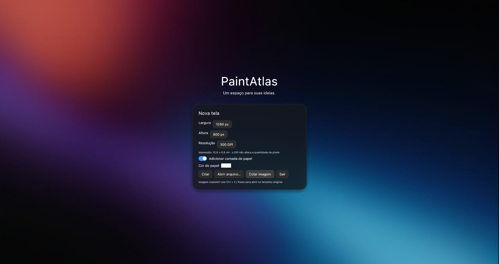

# PaintAtlas

A raster drawing studio for Linux, built in **Rust**, with a Portuguese-language interface. A personal project inspired by Clip Studio Paint's illustration workflow: pressure-sensitive brushes, layers, selections, and transforms, with dockable panels and translucent glass styling.



## Build and run

Requirements: stable Rust with Cargo, a C compiler/linker, a Linux desktop session, and OpenGL-capable graphics drivers. File dialogs use `xdg-desktop-portal` and your desktop's portal backend; GTK is not required to build. Install the system `curl` utility to import images from URLs.

From the project directory:

```bash
./compilar.sh
./target/debug/paintatlas
```

Or run directly with Cargo:

```bash
cargo run
```

For an optimized build:

```bash
./compilar.sh --release
./target/release/paintatlas
```

Keep `default_brushes/` next to the executable when distributing a local copy with the brush tip pack. The splash background and Inter font are embedded in the executable.

## Start drawing

The app opens maximized with a splash screen and a centered canvas creation menu. Choose the width, height, DPI, and paper color, open a project or image, or press **Ctrl+V** to create a canvas from a copied image at its original size, preserving transparency. The **Paste image** button does the same. Custom paste shortcuts are also respected. UI labels in this README are translated for reference; the app itself currently uses Portuguese.

Canvas creation settings are saved for future canvases. New canvases start with black as the drawing color. Multiple documents can be opened in tabs; closing the last one returns to the splash screen.

Save as **`.patlas`** to preserve layers. Exporting PNG produces a flattened image and does not replace the editable project. Hide the paper layer to export with transparency.

## Features

### Drawing and brushes

- Brush and eraser controls for size, opacity, hardness, spacing, stabilization, and pressure dynamics.
- Textured tips from `default_brushes/` and support for importing brush tip images.
- Preset list with stroke previews, brush creation, and an option to save adjustments as a new preset.
- Brush size palette from **1 to 1000 px**, with buttons and circular previews.
- Brush outline, circle, or dot cursor. Pressure-based resizing is optional for the circle cursor and disabled by default.
- Contiguous fill with tolerance, eyedropper, lines, rectangles, and ellipses.
- Rectangular and triangular HSV color selectors that adapt to the panel size.

Stabilization ranges from 0% to 100%. Higher values introduce an intentional delay to smooth the stroke; a guide between the pen and brush tip shows the effect. Pressure dynamics let you adjust the pressure curve and minimum size or disable thickness variation.

Choose the brush mask under **Properties → Tip / texture**. Transparent tips use their alpha channel; dark regions represent ink in opaque images. Imported tips are copied to `brush_tips/` alongside the preferences, and custom presets persist between sessions.

### Layers and blend modes

Layers support thumbnails, names, visibility, opacity, alpha lock, duplication, and deletion. Drag a thumbnail or layer name to reorder. Animated feedback follows the drag and can be disabled with **Reduce motion**.

The selector above layer opacity offers 18 modes: Normal, Multiply, Screen, Overlay, Soft Light, Hard Light, Darken, Lighten, Color Dodge, Color Burn, Difference, Exclusion, Add, Subtract, Hue, Saturation, Color, and Luminosity. Blend mode changes can be undone.

**Alpha lock** lets you recolor existing pixels without changing their alpha. Erasing and clearing are blocked while it is enabled.

### Selections and transforms

Rectangular and lasso selections support adding, subtracting, and inverting areas. Brushes, erasers, shapes, and fills respect the selection. A contextual toolbar below the selection provides transform, duplicate selection content, invert, delete, and deselect actions.

During a transform, drag inside to move, drag handles to resize, and drag outside the corners to rotate. Corner handles preserve proportions by default; Shift toggles this behavior and also enables rotation snapping. Horizontal/vertical flipping and reset controls are available. **Enter** applies a single history action; **Esc** cancels. The preview avoids repeatedly resampling the pixels.

Selections are temporary. Permanent layer masks are not available yet.

### Copy, paste, and import images

**Ctrl+C** copies the active layer's selected region or the entire layer. **Ctrl+Shift+C** copies the visible composite, restricted to the selection when present. Copy a region, switch tabs, and paste to transfer content between canvases.

On an open canvas, **Ctrl+V** starts a provisional new layer: move, resize, or rotate it, then apply or cancel. Large images are scaled down to fit the editing area. On the splash screen, pasting creates a canvas with the image's original dimensions.

Drag images from a file manager or browser to import them. Supported formats are PNG, JPEG, WebP, BMP, and the first frame of GIF files. Drag-and-drop import accepts up to eight images at a time and 32 MiB per file; each image waits for the previous one to be applied or canceled. Downloads and decoding run outside the UI thread, and canceling stops a pending download.

The browser must provide a file or an HTTP/HTTPS or `data:image` image URL. For `blob:` URLs and sites requiring authentication or blocking downloads, use **Copy image** in the browser and paste into the app. Dragging does not change the system clipboard.

### Interface and settings

- Panels can dock at canvas edges, share tabs, float, or open in native windows, with a persistent layout.
- Tools switch to icon-only buttons in narrow panels.
- Smooth zoom and rotation, panning, and view mirroring.
- Translucent glass with OpenGL blur: the canvas can appear behind panels when zooming or panning.
- Settings for the cursor, GPU, colors, appearance, and shortcuts.
- Accent colors, glass intensity, and reduced motion.

The selected GPU takes effect after restarting the app. The canvas and UI share the OpenGL context. If the saved GPU is unavailable, the app uses automatic selection.

The bundled font is Inter, under the license in `assets/fonts/OFL.txt`. For local use, the UI prefers `SF-Pro-Text-Regular.otf` in `$XDG_DATA_HOME/paintatlas/fonts/` or `~/.local/share/paintatlas/fonts/`. This local font is not included in the repository or executable.

## Default shortcuts

All shortcuts can be changed under **Settings → Shortcuts**, including alternative bindings and gesture modifiers. The UI identifies conflicts and saves changes automatically.

| Action | Shortcut |
|---|---|
| Brush / eraser | B / E |
| Fill / eyedropper | G / I |
| Line / rectangle / ellipse | L / R / O |
| Rectangular selection / lasso | S / A |
| Transform selection | Ctrl+T |
| Select all / deselect | Ctrl+A / Ctrl+D |
| Apply / cancel transform | Enter / Esc |
| Delete selection content | Delete |
| Move object during transform | Arrow keys; Shift+arrows for 10 px |
| Hand / temporarily pan | H / Space+drag |
| Temporary eyedropper | Alt+click |
| Decrease / increase brush size | [ / ] |
| Brush sizes | F6 |
| Zoom | Mouse wheel, Ctrl++ / Ctrl+- |
| 100% zoom / fit to window | Ctrl+0 / F |
| Rotate view −15° / +15° | Q / W |
| Mirror view | M |
| Copy / copy merged / paste | Ctrl+C / Ctrl+Shift+C / Ctrl+V |
| Undo / redo | Ctrl+Z / Ctrl+Shift+Z or Ctrl+Y |
| New / open / save | Ctrl+N / Ctrl+O / Ctrl+S |
| Close canvas / export PNG | Ctrl+W / Ctrl+E |

## Drawing tablets on Linux

When `DISPLAY` is available, the app uses X11 or XWayland for pen input. Pressure is primarily read through **XInput2** from the stylus exposed by the driver, including the `xwayland-tablet stylus` used by XP-Pen's PenTablet driver. Monitor mapping remains under desktop/driver control.

If pressure is unavailable from that source, the app tries evdev without exclusive capture. This requires read access to the device in `/dev/input`. The app does not change permissions and should not be run as root. Device discovery is repeated while the app is running.

To observe the input source and pressure for 20 seconds:

```bash
./target/debug/paintatlas --tablet-diagnostics
```

Automated validation does not replace testing contact, pressure, and the dial with a physical tablet.

## Projects, preferences, and limits

- **`.patlas` v4** projects preserve pixels, layers, opacity, visibility, alpha lock, DPI, and blend modes. Versions v1–v3 are migrated when opened; older app versions cannot open v4.
- Per-document limits: **4096 × 4096 pixels**, up to **32 layers**, and **256 MiB** of pixel data. The memory limit may prevent reaching both the maximum dimensions and layer count at the same time.
- History: up to **30 actions**, with a target budget of **128 MiB**. Older actions are removed when the budget is exceeded; at least one is retained. History belongs to each document's session and is not saved in the project.
- DPI is print metadata and does not multiply the pixel count. Exported PNG files include resolution metadata.
- Preferences and presets: `$XDG_CONFIG_HOME/paintatlas/brushes.json` or `~/.config/paintatlas/brushes.json`. The panel layout also persists.
- Automatic crash recovery, `.clip`/PSD compatibility, text/vector tools, and pen tilt support are not available yet. Save regularly.

Brushes rasterize on the CPU; previews and blend modes use OpenGL. During freehand drawing, only changed blocks are uploaded to the GPU and recorded in history. Shapes and some structural operations can still be expensive on large documents.

## Development

| File or directory | Responsibility |
|---|---|
| `src/main.rs`, `src/app.rs` | Startup, UI, splash screen, and commands |
| `src/document.rs`, `src/painting.rs`, `src/history.rs` | Pixels, drawing, and history |
| `src/brush_tip.rs`, `src/presets.rs`, `src/brush_sizes.rs` | Tips, presets, and sizes |
| `src/documents_ui.rs`, `src/workspace.rs` | Documents and docking |
| `src/selection*.rs` | Masks, transforms, and previews |
| `src/blend.rs`, `src/blend_gpu.rs` | CPU/GPU blend modes |
| `src/clipboard*.rs`, `src/image_drop*.rs` | Clipboard and drag-and-drop import |
| `src/tablet.rs`, `src/tablet/` | Pen input and pressure |
| `src/shortcuts.rs`, `src/shortcut_settings.rs` | Shortcut registry and configuration |
| `src/theme.rs`, `src/glass_gpu.rs`, `src/canvas_backdrop.rs` | Appearance, glass, and canvas backdrop |
| `assets/`, `default_brushes/` | Visual assets and brush tip pack |
| `vendor/` | Dependencies with local modifications |

**Every future feature with a shortcut must register its action in `src/shortcuts.rs` and use the configurable shortcut system.** This requirement is also highlighted in the source code.

The copies in `vendor/egui_dock`, `vendor/egui-winit`, and `vendor/winit` are part of the build. Do not remove them: they include docking, image clipboard, and Linux drag-and-drop fixes. Vendored dependency licenses remain in their respective directories.

Validation:

```bash
cargo fmt --all -- --check
cargo test --all-targets
cargo clippy --all-targets -- -D warnings
```

Capture the splash screen in a separate run without using your preferences:

```bash
PAINTATLAS_SETTINGS=/tmp/paintatlas-preview-settings.json \
PAINTATLAS_WORKSPACE=/tmp/paintatlas-preview-workspace.bin \
PAINTATLAS_SMOKE_SCENE=startup \
PAINTATLAS_SCREENSHOT=/tmp/paintatlas-splash.png \
cargo run
```

The app exits this run after saving the screenshot. Other screenshots and an earlier analysis are in `docs/`; older materials may show previous versions of the interface.

## Git

The local repository uses the `main` branch. Source code, assets, documentation, `Cargo.lock`, and modified dependencies in `vendor/` should be versioned. The `target/` directory, caches, and local environment files are ignored; rebuilding recreates the executables.

```bash
git status
git diff
git diff --cached
```

To record changes, configure your identity if it is not already set and create a commit:

```bash
git config user.name "Your name"
git config user.email "your-email@example.com"
git add .
git commit -m "Update PaintAtlas"
```

No remote repository is configured. To connect to a repository you have created:

```bash
git remote add origin REPOSITORY_URL
git push -u origin main
```
