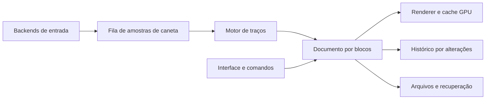

# PaintAtlas: análise técnica e aproximação ao Clip Studio Paint

Nota: este relatório registra o estado anterior à implementação de estabilização, curva de pressão, giro/espelhamento, presets persistentes e bloqueio de transparência. Para os recursos atuais, consulte o README.

Data: 23 de outubro de 2026. Escopo: código atual, testes automatizados e documentação pública do Clip Studio Paint. Este relatório não é um benchmark de desempenho nem uma validação física das mesas. A análise não altera o funcionamento do aplicativo.

## Diagnóstico

O PaintAtlas é um protótipo raster funcional, com aproximadamente 2.074 linhas de Rust distribuídas em cinco arquivos. Já permite desenhar, organizar camadas básicas, desfazer ações e persistir projetos. Ainda não tem o motor de traços, a estrutura de documentos e o conjunto de operações de um editor de ilustração maduro.

Para chegar perto do Clip Studio, as prioridades são: entrada de caneta confiável, qualidade do traço, memória/histórico escaláveis, seleção/transformação e um fluxo de camadas completo. A semelhança visual pode avançar junto, mas não resolve essas dependências.

Uma meta inicial coerente é reproduzir o fluxo de **ilustração e lineart**: esboçar, fazer arte-final, selecionar/corrigir proporções, preencher em uma camada separada, sombrear com clipping e exportar. Vetores avançados, quadrinhos multipágina, animação e 3D ampliam bastante o escopo.

## O que já está aproveitável

- Rust com eframe/egui para a interface e OpenGL para a prévia.
- Uma textura por camada, com envio parcial da região alterada em traços livres.
- Pixels RGBA, composição normal, pincel circular, borracha, formas e preenchimento contíguo.
- Camadas com opacidade, visibilidade, ordem, duplicação e exclusão.
- Zoom centrado no cursor, movimento da tela e atalhos básicos.
- Histórico, formato próprio versionado por cabeçalho e gravação por substituição de arquivo temporário.
- Importação de imagens com limites de dimensões/alocação e testes de ida e volta de arquivos.
- Backends de leitura de pressão via XInput2 e evdev.

Essas partes podem ser preservadas como referência funcional e caminho inicial de implementação. Não há necessidade de abandonar Rust ou trocar toda a interface para começar a evolução.

## Principais limitações encontradas no código

### 1. Movimento e pressão não formam uma amostra única

Em `src/tablet/xinput.rs:51`, a pressão é obtida por uma consulta a todos os dispositivos XInput2. Em `src/app.rs:686`, as posições vêm dos eventos do egui. Uma mesma pressão consultada no quadro é aplicada às várias posições processadas naquele quadro.

Consequências possíveis: a espessura não acompanha exatamente cada ponto do traço, amostras intermediárias de pressão se perdem e o resultado depende do ritmo de atualização da interface. O código ainda pode conservar a última pressão durante um gesto ou usar 100% quando não há pressão positiva. Isso exige testes específicos de início e fim do contato, para evitar marcas grossas ou pontas incorretas.

**Mudança necessária:** produzir eventos unificados com posição, pressão, instante, proximidade, contato, inclinação, identificação da ferramenta e identificação do dispositivo. O pincel deve consumir essa fila, e não consultar o estado atual do driver para reconstruir o passado. Adotar eventos XI2 no X11 e um backend de tablet apropriado no Wayland; manter evdev como alternativa explícita quando necessário. Separar enumeração/hotplug da leitura frequente das amostras.

O tratamento deve distinguir mouse, caneta, borracha e botões laterais. Escolher a fonte da caneta de forma estável durante um traço. Os conflitos observados com Deco/Artist mostram que isso é uma prioridade funcional, mesmo com testes unitários aprovados.

### 2. O histórico copia o documento inteiro

`History::push`, em `src/document.rs:382`, executa `doc.clone()`. Isso inclui todos os pixels de todas as camadas, inclusive para alterações pequenas ou mudanças de metadados.

Uma camada RGBA de 4096 × 4096 ocupa **64 MiB** apenas em pixels. Papel mais uma camada já ocupam 128 MiB. Cada checkpoint duplica esses pixels antes de a política de descarte do histórico ser aplicada. Texturas e buffers temporários ainda usam memória adicional.

O limite declarado de 32 camadas também não se aplica a todas as resoluções: com o teto atual de 256 MiB de pixels, uma tela 4096 × 4096 comporta no máximo quatro camadas completas.

**Mudança necessária:** armazenamento esparso por blocos, por exemplo de 128 × 128 ou 256 × 256 pixels, alocados conforme o desenho. Histórico com estados anteriores/posteriores apenas dos blocos alterados e comandos pequenos para mudanças como nome/visibilidade. Compartilhamento de blocos imutáveis pode reduzir cópias. O tamanho dos blocos deve ser escolhido com medições.

### 3. OpenGL já participa da prévia, mas o pincel continua na CPU

`Document::stamp`, em `src/document.rs:148`, percorre pixels para cada marca. O espaçamento está fixado em aproximadamente 15% do diâmetro, com limite mínimo de 0,5 pixel. Isso é suficiente para uma caneta circular simples, mas não representa um motor de pincéis completo.

Em `src/app.rs:736`, traços livres usam atualização parcial. Quando não existe região alterada, o aplicativo destrói e recria todas as texturas das camadas. Essa via também é acionada por diversas alterações de estado e por prévias de formas. Não é necessário reenviar pixels para apenas mudar visibilidade ou opacidade.

**Mudança necessária:** manter identificadores estáveis de camadas e texturas; distinguir alterações de pixels, estrutura e metadados; atualizar somente os blocos afetados. Formas devem ter prévia temporária, sem restaurar/copiar uma camada inteira a cada movimento. Perfilar o pincel antes de decidir quais operações migrar para shaders. Usar OpenGL não elimina custos de cópia, histórico ou entrada.

Também é necessário definir uma política de cores e validar equivalência entre composição de exportação na CPU e prévia na GPU, incluindo alfa e arredondamentos. Suporte a perfis ICC e soft proof pode vir em uma etapa posterior; consistência básica deve vir antes.

### 4. A qualidade do traço ainda é limitada

O pincel possui apenas cor, tamanho, opacidade e dureza. A pressão usa uma curva fixa de raiz quadrada e controla somente o tamanho (`src/app.rs:110`). Não há curva editável, tamanho mínimo configurável, estabilização, tratamento de velocidade, início/fim do traço, textura ou mistura de cores.

A opacidade atua por marca e acumula conforme as passagens; não existe um buffer de cobertura do traço para oferecer outra semântica de opacidade. Isso deve ser uma decisão explícita por pincel, diferenciando fluxo e opacidade.

**Mudança necessária:** um motor de traços separado, com reamostragem por distância, interpolação de pressão, espaçamento configurável, estabilização com latência ajustável e curvas de dinâmica por parâmetro. Os primeiros presets úteis seriam caneta de arte-final, lápis, pincel opaco, aerógrafo e borracha, com configurações persistidas.

### 5. A interface concentra responsabilidades demais

`src/app.rs` tem aproximadamente 1.159 linhas e reúne entrada, operações de documento, renderização, ferramentas, diálogos, atalhos e persistência. Os painéis têm larguras fixas e não são reorganizáveis. Os atalhos estão codificados diretamente na implementação.

**Mudança necessária:** separar comandos de edição e estado do documento dos widgets. Criar painéis de ferramentas/subferramentas, propriedades, navegador, cores, histórico e camadas com miniaturas. Permitir redimensionamento, encaixe, recolhimento e salvamento do workspace. Atalhos e dial devem ser configuráveis por ação, com modificadores e diagnóstico dos eventos recebidos.

É razoável manter egui durante essas etapas. A capacidade e o custo de personalizar os painéis devem ser avaliados antes de escolher outra biblioteca de interface.

### 6. Arquivos e segurança do trabalho ainda são de protótipo

O formato `.patlas` serializa a estrutura atual inteira com bincode, em memória, antes da gravação. Há cabeçalho e validações, mas ainda não há migrações de esquema, chunks independentes, recuperação ou salvamento automático. A gravação atômica é uma boa base, mas não recupera trabalho que nunca foi salvo.

**Mudança necessária:** versão explícita de esquema, migração, blocos comprimidos, metadados, miniatura e validação de integridade; salvamento em segundo plano de um snapshot consistente; recuperação periódica após falha; tratamento testado de falta de espaço e arquivos interrompidos. Projetos antigos precisam de testes de compatibilidade.

## Comparação funcional

| Área | PaintAtlas atual | Necessário para um fluxo próximo ao Clip Studio | Prioridade |
|---|---|---|---|
| Caneta | Consulta de pressão separada dos movimentos | Amostras sincronizadas, contato/proximidade, curva e calibração | P0 |
| Pincéis | Circular, três presets temporários | Estabilização, pontas/texturas, dinâmica, presets editáveis e persistidos | P1 |
| Documento/histórico | Buffers completos e snapshots integrais | Blocos esparsos, undo por região/comando, operações assíncronas | P0 |
| Canvas | Zoom e pan | Rotação, espelhamento de visualização, navegador e múltiplos documentos | P1 |
| Camadas | Raster e composição normal | Bloqueio, alpha lock, clipping, máscaras, grupos, mesclagem e modos de mistura | P1 |
| Seleção | Ausente | Retângulo, elipse, laço, varinha, combinar/inverter/expandir/suavizar | P1 |
| Transformação | Ausente | Mover, escalar, girar, inverter; depois perspectiva e deformação | P1 |
| Preenchimento | Camada ativa, tolerância RGBA | Referir lineart em outra camada, expansão, fechamento de lacunas, antialias | P1 |
| Interface | Painéis fixos | Subferramentas, miniaturas, workspace salvo, atalhos configuráveis | P1 |
| Cor | RGBA de 8 bits e paleta fixa | Paletas/histórico persistidos, consistência CPU/GPU, perfis de cor | P1–P2 |
| Vetores | Ausentes | Traços editáveis, largura variável, operações por interseção | P2 |
| Quadrinhos | Ausentes | Réguas/simetria, perspectiva, texto, balões, quadros e retículas | P2–P3 |
| Formatos | PATLAS e imagens raster | OpenRaster para intercâmbio de camadas; avaliar subconjunto PSD | P2 |
| Animação/3D | Ausentes | Timeline, onion skin e exportação; materiais/poses 3D como módulos próprios | P3 |

P0 significa fundação necessária; P1 é o primeiro fluxo de ilustração completo. P2/P3 dependem do foco do produto. Isso não é uma estimativa de calendário.

## Recursos que mais aproximam a experiência do Clip Studio

- **Traço:** estabilização, pressão configurável e início/fim bem resolvidos. O manual do Clip Studio documenta estabilização ajustável e correção por velocidade. [Referência oficial](https://help.clip-studio.com/en-us/manual_en/810_subtools/C.htm).
- **Colorização:** desenhar lineart acima e preencher em outra camada, com referência, expansão e fechamento de lacunas. O preenchimento atual não oferece esse fluxo. [Referência oficial](https://help.clip-studio.com/en-us/manual_en/420_fill/Advanced_Fill.htm).
- **Edição não destrutiva:** alpha lock, clipping e máscaras, junto de seleções e transformações. [Camadas](https://help.clip-studio.com/en-us/manual_en/180_layers/Other_layer_settings.htm) e [transformações](https://help.clip-studio.com/en-us/manual_en/360_transform/Transform_using_the_bounding_box.htm).
- **Lineart vetorial:** guardar caminhos e largura variável, para corrigir espessura e apagar até interseções. É um modelo adicional ao raster, não um filtro aplicado à imagem. [Referência oficial](https://help.clip-studio.com/en-us/manual_en/180_layers/Vector_layers.htm?rhhlterm=svg&rhsearch=svg).
- **Organização:** paletas encaixáveis e workspaces salvos, adaptados às etapas do desenho. [Referência oficial](https://help.clip-studio.com/en-us/manual_en/690_interface/Register_and_manage_your_workspace.htm).

A proposta é aproximar o comportamento e o fluxo com identidade própria. Compatibilidade com `.clip`, `.sut` e materiais do ecossistema deve ser tratada como investigação independente: ela não existe no código e não deve ser prometida como consequência de uma interface parecida.

## Arquitetura sugerida

Organização possível, sem reescrever tudo de uma vez:

- `input/`: eventos de caneta, mouse e dial; backends; perfis e calibração.
- `engine/`: traços, pincéis, reamostragem e estabilização.
- `document/`: blocos, camadas, seleções e identificadores estáveis.
- `commands/`: operações editáveis e histórico.
- `render/`: texturas por bloco, composição, transformações de visualização e previews.
- `io/`: formato, importação, exportação e recuperação.
- `ui/`: painéis, workspace e editor de atalhos.

A representação dos blocos e o contrato de comandos devem ser definidos antes de implementar dezenas de ferramentas. A seleção, por exemplo, precisa ser uma máscara reutilizável por pincel, preenchimento e transformação, em vez de três implementações independentes.

## Ordem de desenvolvimento e critérios de conclusão

1. **Entrada confiável.** Registrar e reproduzir sessões de caneta/dial; pressão e posição no mesmo evento; testes reais nas Deco 640 e Artist 12 Pro, incluindo conectar depois de abrir, trocar de monitor e retomar de suspensão. Critério: contato, pressão e ambos os sentidos do dial funcionam sem reiniciar ou alternar fontes durante o traço.
2. **Documento e histórico escaláveis.** Introduzir blocos e comandos; conservar arquivos antigos; remover snapshots completos por ação. Critério: memória acompanha as regiões pintadas e o undo preserva pixels e metadados.
3. **Primeiro fluxo artístico completo.** Pincéis persistidos, curvas de pressão, estabilização, seleção/laço, transformações, alpha lock, clipping, grupos e preenchimento por referência. Critério: concluir uma ilustração de esboço a exportação sem depender de outro editor para correções básicas.
4. **Confiabilidade e workspace.** Recuperação automática, salvar em segundo plano, múltiplos documentos, painéis configuráveis, miniaturas e atalhos. Critério: restaurar um projeto após encerramento inesperado e reabrir o workspace com as mesmas configurações.
5. **Diferenciais de lineart/quadrinhos.** Vetores, interseções, réguas, simetria, texto, balões e retículas. Critério: demonstrar fluxos completos de arte-final e página de quadrinhos.
6. **Expansões.** Intercâmbio avançado, animação e 3D conforme demanda. Cada um desses módulos exige planejamento e testes próprios.

## Validação e desempenho

Na análise, `cargo test` passou com **16 testes**. Eles verificam matemática de pixels, arquivos, regiões alteradas e eventos simulados da interface. Isso não valida a pressão física no driver, o mapeamento em múltiplos monitores, o comportamento real do dial ou a latência ponta a ponta.

Faltam sessões gravadas de entrada, benchmarks, testes visuais do renderer, matriz de hardware, recuperação de arquivos e integração contínua. Medir separadamente aquisição de entrada, construção do traço, rasterização, cópia de memória, upload e apresentação.

Alvos iniciais de validação, a confirmar no hardware do usuário:

- Orçamento de quadro de 16,7 ms para 60 FPS durante desenho normal. Isso não equivale a garantir latência total da caneta de 16,7 ms.
- Perfis de teste com telas de 2K, 4K e maiores, variadas quantidades de camadas e pincéis pequenos/grandes.
- Testes de pressão leve/forte, pontas, mudanças rápidas e curvas lentas, repetidos com diferentes taxas de quadros.
- Equivalência visual entre prévia e exportação e entre estados antes/depois de desfazer.
- Memória e duração do histórico registradas em sessões longas; perdas de energia, falta de espaço e arquivo truncado tratados.

Minha recomendação é fechar primeiro o núcleo de desenho e o fluxo raster de ilustração. Isso aproxima a experiência do Clip Studio de forma perceptível e cria uma base utilizável para as funções mais caras.
