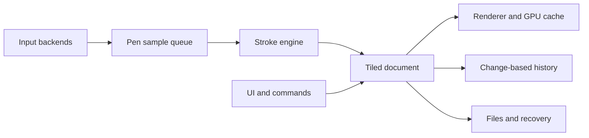

# PaintAtlas: Technical Assessment and Comparison with Clip Studio Paint

**Note:** This report records the project before stabilization, pressure curves,
rotation/mirroring, persistent presets, and alpha locking were implemented. See
the README for current features.

Date: October 23, 2026. Scope: project code, automated tests, and public Clip
Studio Paint documentation. This is neither a performance benchmark nor a
physical tablet validation. The assessment does not change application behavior.

## Assessment

PaintAtlas is a functional raster prototype, with approximately 2,074 lines of
Rust across five files. It can draw, organize basic layers, undo actions, and
save projects. It does not yet have the stroke engine, document architecture,
or range of operations found in a mature illustration editor.

To approach Clip Studio, the priorities are reliable pen input, stroke quality,
scalable memory/history, selection/transformation, and a complete layer workflow.
Visual similarity can progress in parallel, but it does not resolve these
foundational dependencies.

A coherent initial goal is to support an **illustration and line-art** workflow:
sketch, ink, select and correct proportions, fill on a separate layer, shade
with clipping, and export. Advanced vectors, multipage comics, animation, and 3D
substantially expand the scope.

## Existing foundations worth keeping

- Rust with eframe/egui for the interface and OpenGL for previews.
- One texture per layer, with partial uploads for changed freehand regions.
- RGBA pixels, normal compositing, a circular brush, eraser, shapes, and
  contiguous fill.
- Layers with opacity, visibility, ordering, duplication, and deletion.
- Cursor-centered zoom, canvas panning, and basic shortcuts.
- History, a versioned native format, and temporary-file replacement when saving.
- Image import with dimension/allocation limits and file round-trip tests.
- Pressure-reading backends using XInput2 and evdev.

These can be preserved as functional references and as an initial path for
implementation. There is no need to abandon Rust or replace the entire UI to
begin evolving the application.

## Main limitations found in the code

### 1. Movement and pressure are not a single sample

In `src/tablet/xinput.rs:51`, pressure is obtained by querying all XInput2
devices. In `src/app.rs:686`, positions come from egui events. One pressure
value queried for a frame is applied to the multiple positions processed in that
frame.

Possible consequences include brush width not matching each point precisely,
lost intermediate pressure samples, and results depending on UI refresh rate.
The code may also retain the last pressure during a gesture or use 100% when no
positive pressure is available. Contact-start and contact-end tests are needed
to prevent thick marks or incorrect endpoints.

**Required change:** produce unified events containing position, pressure,
timestamp, proximity, contact, tilt, tool identity, and device identity. The
brush should consume this queue rather than query the driver's current state to
reconstruct past input. Use XI2 events on X11 and an appropriate tablet backend
on Wayland; keep evdev as an explicit fallback where needed. Separate device
enumeration/hot-plug handling from frequent sample reads.

Input handling must distinguish mouse, pen, eraser, and side buttons, and keep
the pen source stable during a stroke. Issues observed with Deco/Artist tablets
make this a functional priority, even when unit tests pass.

### 2. History copies the entire document

`History::push`, at `src/document.rs:382`, calls `doc.clone()`. This includes all
pixels in every layer, even for small edits or metadata changes.

A 4096 × 4096 RGBA layer occupies **64 MiB** in pixels alone. A background plus
one layer already occupies 128 MiB. Each checkpoint duplicates those pixels
before the history eviction policy is applied. Textures and temporary buffers
require additional memory.

The declared 32-layer limit also does not apply at every resolution: with the
current 256 MiB pixel limit, a 4096 × 4096 canvas can hold at most four full
layers.

**Required change:** use sparse storage in tiles, such as 128 × 128 or 256 × 256
pixels, allocated as needed. Store only before/after states for changed tiles
and small commands for changes such as name/visibility. Sharing immutable tiles
could reduce copying. Choose tile size through measurement.

### 3. OpenGL participates in previews, but the brush still runs on the CPU

`Document::stamp` in `src/document.rs:148` walks pixels for every stamp. Spacing
is fixed at approximately 15% of the diameter, with a minimum of 0.5 pixels.
This is sufficient for a simple circular pen, but it is not a full brush engine.

At `src/app.rs:736`, freehand strokes use partial updates. If there is no dirty
region, the app destroys and recreates every layer texture. Several state
changes and shape previews also take this path. Pixel uploads are unnecessary
for visibility or opacity changes alone.

**Required change:** keep stable layer and texture identifiers; distinguish
pixel, structure, and metadata changes; update only affected tiles. Shapes
should use temporary previews instead of restoring/copying a full layer on each
pointer movement. Profile the brush before deciding which operations to move to
shaders. OpenGL does not eliminate input, history, or copy costs.

Define a color policy and validate CPU export compositing against GPU previews,
including alpha and rounding. ICC profiles and soft proofing can come later;
basic consistency comes first.

### 4. Stroke quality is still limited

The brush has only color, size, opacity, and hardness. Pressure uses a fixed
square-root curve and controls only size (`src/app.rs:110`). There is no editable
curve, configurable minimum size, stabilization, velocity handling, stroke
start/end dynamics, texture, or color mixing.

Opacity is applied per stamp and accumulates with repeated passes; there is no
stroke coverage buffer for alternative opacity semantics. The brush should make
an explicit distinction between flow and opacity.

**Required change:** create a separate stroke engine with distance-based
resampling, pressure interpolation, configurable spacing, adjustable-latency
stabilization, and per-parameter dynamics curves. Useful initial presets include
an inking pen, pencil, opaque brush, airbrush, and eraser, with persistent
settings.

### 5. The interface has too many responsibilities in one place

`src/app.rs` is approximately 1,159 lines and combines input, document
operations, rendering, tools, dialogs, shortcuts, and persistence. Panels have
fixed widths and cannot be rearranged. Shortcuts are embedded in the
implementation.

**Required change:** separate editing commands and document state from widgets.
Create panels for tools/subtools, properties, navigator, colors, history, and
layer thumbnails. Support resizing, docking, collapsing, and saved workspaces.
Make shortcuts and dial actions configurable, with modifiers and diagnostics for
received events.

Keeping egui during these stages is reasonable. Evaluate the capability and cost
of customizing its panels before choosing another UI library.

### 6. Project files and work safety are still at prototype level

The `.patlas` format serializes the entire current structure with bincode in
memory before writing. It has a header and validation, but no schema migrations,
independent chunks, recovery, or autosave. Atomic saving is a good foundation,
but it cannot recover work that was never saved.

**Required change:** add explicit schema versions, migrations, compressed
chunks, metadata, a thumbnail, and integrity checks; save a consistent snapshot
in the background; periodically recover after crashes; test disk-full and
interrupted-file handling. Older projects need compatibility tests.

## Feature comparison

| Area | PaintAtlas today | Needed for a Clip Studio-like workflow | Priority |
|---|---|---|---|
| Pen | Pressure queried separately from movement | Synchronized samples, contact/proximity, curve, calibration | P0 |
| Brushes | Circular, three temporary presets | Stabilization, tips/textures, dynamics, editable persistent presets | P1 |
| Document/history | Full buffers and snapshots | Sparse tiles, region/command undo, asynchronous operations | P0 |
| Canvas | Zoom and pan | Rotation, view mirroring, navigator, multiple documents | P1 |
| Layers | Raster and normal compositing | Lock, alpha lock, clipping, masks, groups, merge, blend modes | P1 |
| Selection | Missing | Rectangle, ellipse, lasso, wand, combine/invert/expand/feather | P1 |
| Transform | Missing | Move, scale, rotate, flip; later perspective and warp | P1 |
| Fill | Active layer, RGBA tolerance | Reference line art on another layer, expansion, gap closing, antialias | P1 |
| Interface | Fixed panels | Subtools, thumbnails, saved workspace, configurable shortcuts | P1 |
| Color | 8-bit RGBA and fixed palette | Persistent palettes/history, CPU/GPU consistency, color profiles | P1–P2 |
| Vectors | Missing | Editable strokes, variable width, intersection operations | P2 |
| Comics | Missing | Rulers/symmetry, perspective, text, bubbles, frames, screen tones | P2–P3 |
| Formats | PATLAS and raster images | OpenRaster layer exchange; assess a PSD subset | P2 |
| Animation/3D | Missing | Timeline, onion skin, export; 3D materials/poses as separate modules | P3 |

P0 means required foundation; P1 is the first complete illustration workflow.
P2/P3 depend on product focus. These labels are not schedule estimates.

## Features that most improve the Clip Studio-like experience

- **Strokes:** stabilization, configurable pressure, and well-defined start/end
  dynamics. The Clip Studio manual documents adjustable stabilization and
  velocity correction. [Official reference](https://help.clip-studio.com/en-us/manual_en/810_subtools/C.htm).
- **Coloring:** draw line art above and fill on another layer, with reference,
  expansion, and gap closing. Current fill does not support this workflow.
  [Official reference](https://help.clip-studio.com/en-us/manual_en/420_fill/Advanced_Fill.htm).
- **Non-destructive editing:** alpha lock, clipping, and masks, together with
  selections and transforms. [Layers](https://help.clip-studio.com/en-us/manual_en/180_layers/Other_layer_settings.htm)
  and [transforms](https://help.clip-studio.com/en-us/manual_en/360_transform/Transform_using_the_bounding_box.htm).
- **Vector line art:** store paths and variable width so users can correct
  thickness and erase to intersections. This is an additional model to raster,
  not an image filter. [Official reference](https://help.clip-studio.com/en-us/manual_en/180_layers/Vector_layers.htm?rhhlterm=svg&rhsearch=svg).
- **Organization:** dockable palettes and saved workspaces adapted to drawing
  stages. [Official reference](https://help.clip-studio.com/en-us/manual_en/690_interface/Register_and_manage_your_workspace.htm).

The goal is to approach the behavior and workflow while keeping a distinct
identity. Compatibility with `.clip`, `.sut`, and ecosystem materials requires
independent research: it is not implemented and must not be promised as a result
of a similar interface.

## Suggested architecture

One possible organization, without rewriting everything at once:

- `input/`: pen, mouse, and dial events; backends; profiles and calibration.
- `engine/`: strokes, brushes, resampling, and stabilization.
- `document/`: tiles, layers, selections, and stable identifiers.
- `commands/`: editable operations and history.
- `render/`: tile textures, compositing, view transforms, and previews.
- `io/`: format, import, export, and recovery.
- `ui/`: panels, workspace, and shortcut editor.

Define tile representation and command contracts before implementing dozens of
tools. For example, selection should be a reusable mask for brush, fill, and
transform, rather than three independent implementations.

## Development order and completion criteria

1. **Reliable input.** Record and replay pen/dial sessions; put pressure and
   position in the same event; test Deco 640 and Artist 12 Pro hardware,
   including connecting after launch, changing monitors, and resuming from sleep.
   Criterion: contact, pressure, and both dial directions work without a
   restart or input-source switch during a stroke.
2. **Scalable document and history.** Introduce tiles and commands; preserve old
   files; remove full snapshots per action. Criterion: memory follows painted
   regions and undo preserves pixels and metadata.
3. **First complete art workflow.** Persistent brushes, pressure curves,
   stabilization, selection/lasso, transforms, alpha lock, clipping, groups,
   and reference fill. Criterion: complete an illustration from sketch to
   export without another editor for basic corrections.
4. **Reliability and workspace.** Autosave, background saving, multiple
   documents, configurable panels, thumbnails, and shortcuts. Criterion: restore
   a project after an unexpected shutdown and reopen the workspace with the same
   settings.
5. **Line-art/comics differentiators.** Vectors, intersections, rulers,
   symmetry, text, bubbles, and screen tones. Criterion: demonstrate complete
   inking and comic-page workflows.
6. **Extensions.** Advanced interchange, animation, and 3D as demand warrants.
   Each module needs its own planning and tests.

## Validation and performance

At the time of this assessment, `cargo test` passed **16 tests**. They cover
pixel math, files, dirty regions, and simulated UI events. This does not validate
physical driver pressure, multi-monitor mapping, real dial behavior, or
end-to-end latency.

Recorded input sessions, benchmarks, renderer visual tests, a hardware matrix,
file recovery, and continuous integration were missing. Measure input
acquisition, stroke construction, rasterization, memory copies, upload, and
presentation separately.

Initial validation targets, to be confirmed on user hardware:

- A 16.7 ms frame budget for 60 FPS during ordinary drawing. This is not a
  guarantee of 16.7 ms total pen latency.
- Test profiles with 2K, 4K, and larger canvases, varying layer counts and small
  and large brushes.
- Light/heavy pressure, taps, quick changes, and slow curves, repeated at
  different frame rates.
- Visual equivalence between preview and export and between states before and
  after undo.
- Record memory and history duration in long sessions; handle power loss, low
  disk space, and truncated files.

My recommendation is to first complete the drawing core and raster illustration
workflow. This would noticeably improve the Clip Studio-like experience and
create a usable base for more expensive features.
